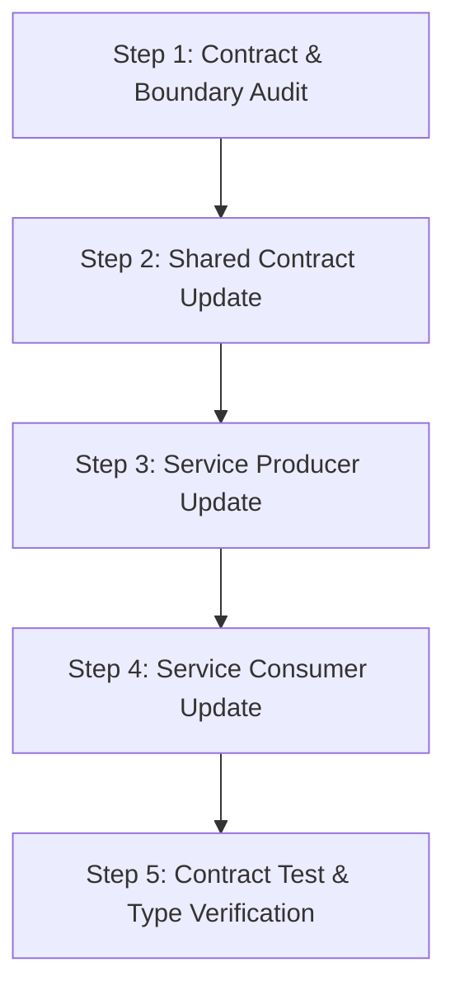

# Microservices Architect & AI Agent Editing Skill

This skill equips AI agents with strict architectural guardrails, contract verification protocols, and multi-service editing standards designed specifically for complex **Microservice Architectures** (Polyrepo or Monorepo).

---

## 1. Core Principles for Microservice AI Editing

When editing or extending code in a microservice codebase, AI agents MUST follow these 5 mandatory principles:

1. **Strict Domain Boundary Enforcement:**
   - NEVER allow direct code or database model imports between distinct microservices.
   - All inter-service communication MUST occur via explicit protocols: REST (OpenAPI/Swagger), gRPC (Protobuf), or Event Messaging (Kafka/RabbitMQ/NATS).
   - Maintain Bounded Contexts. Each service owns its domain entities and database.

2. **Single Source of Truth for API Contracts:**
   - API Specs (OpenAPI schemas, `.proto` files, AsyncAPI specs) are the master contracts.
   - Any change to an API endpoint payload MUST start with updating the contract spec first, followed by synchronized updates to both the Producer (Server) and Consumer (Client/SDK) services.

3. **Full-Stack & Cross-Service Impact Analysis:**
   - Before executing code modifications, perform an impact assessment across all dependent services, API clients, and shared libraries.
   - Identify breaking schema changes early (e.g., field renames, type changes, missing required parameters).

4. **Backward Compatibility & Non-Breaking API Migration:**
   - Never introduce breaking changes to live APIs. Use versioning (`/v1` -> `/v2`), optional fields, or soft deprecation.
   - Ensure database schema migrations are additive and backward-compatible.

5. **Resilience & Distributed Patterns:**
   - Ensure distributed operations handle partial failures gracefully (Circuit Breaker, Retry with Exponential Backoff, Dead Letter Queues, Saga pattern for distributed transactions, Outbox pattern for event publishing).

---

## 2. Multi-Service AI Editing Workflow

Follow this 5-step workflow whenever modifying features across microservices:



### Step 1: Contract & Boundary Audit
- Search for all entrypoints, handlers, and client callers related to the target feature.
- Verify which microservices produce and consume the affected endpoints or event payloads.

### Step 2: Shared Contract Update
- Update `.proto`, OpenAPI JSON/YAML, or shared TypeScript DTO interfaces in `packages/shared-types` or `shared-specs`.
- Generate updated client SDKs or stubs if automated code generation is used.

### Step 3: Service Producer Update
- Implement business logic changes in the producing service.
- Maintain Symmetrical Updates across Handler -> Service Layer -> Repository Layer -> Event Publisher.

### Step 4: Service Consumer Update
- Update calling services to consume the new or modified API/event attributes.
- Ensure fallback handling and timeout configurations remain intact.

### Step 5: Contract Test & Type Verification
- Run cross-service type check (`tsc --noEmit`, `go test`, `cargo check`).
- Execute API contract tests or integration tests to verify zero regressions.

---

## 3. Microservice `.cursor/rules/*.mdc` Template

When creating project-level Cursor rules for microservices, generate `.cursor/rules/microservices.mdc`:

```markdown
---
description: Microservices domain boundary and API contract enforcement
globs: "**/*.{ts,go,py,java,proto}"
alwaysApply: false
---
# Microservice Architecture Standards
- Respect Bounded Contexts. Do NOT import database entities or internal controllers across service boundaries.
- All inter-service calls must use defined OpenAPI/gRPC specs or shared DTO packages.
- Always perform Symmetrical Updates: Update Shared DTOs -> Producer Handler -> Consumer Client.
- Verify Type Checking and API Contract tests before finalizing changes.
```
