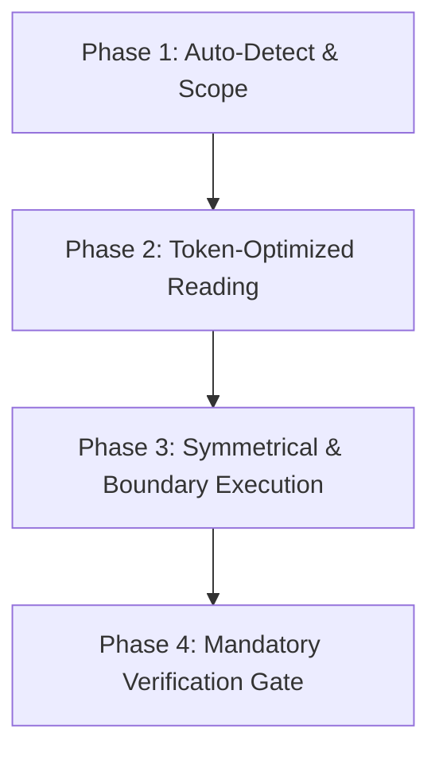

# Unified Master AI Coding Skill (`/code`)

skill รวมศูนย์สำหรับงานแก้โค้ดทุกแบบ ทำงานเองเมื่อเจองานแก้โค้ด หรือพิมพ์ `/code <คำสั่ง>` ก็ได้
รวมแนวทางแก้แบบ surgical, งานหลายไฟล์ และ pipeline แก้บั๊กที่เคยแยกเป็น skill ย่อยไว้ที่นี่แล้ว

---

## Autonomous 4-Phase Workflow

### Phase 1 — Auto-Detect

1. **BUG FIX / ERROR** — มี stack trace หรืออาการบั๊ก
   → reproduce → localize → patch ให้เล็กที่สุด → verify (ดู "Bug pipeline" ข้างล่าง)
2. **FEATURE / FIELD UPDATE (CRUD)** — เพิ่มหรือแก้ field
   → บังคับ **Symmetrical Update**: หน้า list → หน้า detail/form → layer ที่บันทึก → schema/DB
   → ตกอันใดอันหนึ่งคือบั๊ก ไม่ใช่ "ทำทีหลัง"
3. **SCHEMA / PERSISTENCE** — แตะที่เก็บข้อมูล
   → อัปเดต type/model และ layer ที่เขียนพร้อมกัน ห้ามคิดคอลัมน์ที่ไม่มีอยู่จริงขึ้นมาเอง
   → ถ้าโปรเจกต์เป็น DB-first (ไม่มี migration) ให้อ่าน schema จากฐานจริงก่อน
4. **MULTI-FILE / หลายขั้น** — งานที่ต้องแตะหลายส่วน
   → ตัดเป็นก้อนย่อยที่ตรวจผลได้ทีละก้อน หลังผลของแต่ละ tool ให้แยกให้ชัดว่าอะไร "รู้แล้ว" อะไรยังเป็น "สมมติฐาน"
   → ก่อน start dev server ให้ตรวจว่ารันอยู่แล้วหรือไม่ อย่า boot ซ้ำ และยืนยันด้วย HTTP status จริง
   → bind port ไม่ได้ ห้ามเปลี่ยน port เงียบๆ ให้บอก user ก่อน

### Phase 2 — Token-Optimized Reading

ไฟล์ > 800 บรรทัด ให้ใช้กฎของ `/token-saver`: Grep หา symbol ก่อน แล้ว Read เฉพาะช่วง
ก่อนแก้ ให้หาไฟล์ที่กระทบ import และ caller site ด้วยชื่อ symbol

### Phase 3 — Clean Implementation

เขียนให้สะอาดตามกฎ `/ponytail` — ไม่มี fallback ที่ไม่มีใครเรียก ไม่มีฟีเจอร์ที่ยังไม่มีคนขอ
และ **เขียนให้เหมือนโค้ดรอบข้าง** (naming, comment density, สำนวน)
- แก้แบบ surgical ด้วย Edit (exact string match) ไม่ใช่ Write ทับทั้งไฟล์ รักษา indentation และ docstring เดิม
- เจอปัญหาอื่นระหว่างทาง ให้บันทึกไว้ในรายงาน ไม่แก้พ่วงไปเงียบๆ
- เตรียม commit message แบบ conventional ได้ แต่ห้าม commit หรือ push เว้นแต่ user สั่ง

### Bug pipeline

1. อ่านอาการให้จบ แยก "คาดหวังอะไร" กับ "เกิดอะไรขึ้นจริง" ดู test, log และ stack trace ที่มีอยู่ก่อน
2. สร้าง test หรือสคริปต์เล็กที่สุดที่ **fail ได้จริง** เพราะบั๊กนี้ แล้วรันให้เห็นว่า fail ก่อนแตะโค้ด
   ถ้า reproduce ไม่ได้ ให้บอก user อย่าเดาแล้วแก้ บั๊กที่มาจาก env, RLS หรือข้อมูล ใช้ curl, log หรือ SQL ที่ fail แทน test
3. ไล่จาก entrypoint → controller → service → data layer จนชี้ได้ว่าบรรทัดไหนหรือ contract ข้อไหนผิด
4. patch ให้เล็กที่สุด ไม่ refactor นอกขอบเขตบั๊ก
5. รัน reproducer ซ้ำให้ผ่าน แล้วรัน test ที่เกี่ยวข้องเพื่อยืนยันว่าไม่มี regression

### Phase 4 — Mandatory Verification Gate

**ห้ามข้าม** เลือกคำสั่งตาม stack:

| เจอที่ root | gate |
|---|---|
| `artisan` | `php -l <ไฟล์>` + `php artisan view:clear` (ถ้าแก้ blade) + `curl` หน้าจริงอ่าน status code |
| `tsconfig.json` | `npx tsc --noEmit` แล้วค่อย build ถ้าเป็น user-facing |
| `package.json` | อ่าน `scripts` แล้วรันเฉพาะที่มีอยู่จริง |
| `composer.json` (ไม่มี artisan) | `php -l` + script ใน `composer.json` |
| `go.mod` / `Cargo.toml` / `pyproject.toml` | `go build ./...` / `cargo check` / `pytest` หรือเครื่องมือที่ประกาศไว้ |
| มี test suite | รัน test ที่เกี่ยวข้อง แล้ว quote ผล |

ดู stack ก่อนสั่งเสมอ เช่น สั่ง `npx tsc --noEmit` กับโปรเจกต์ที่ไม่มี `tsconfig.json` จะ fail แล้วรายงานผิด

**รายงานผลจริงเท่านั้น** — ถ้า gate ไหนไม่ได้รัน ให้บอกว่าอันไหนและเพราะอะไร

**เปลี่ยนค่าเดียวกันหลายจุด** (สี, class, ข้อความ, ชื่อฟิลด์): ค้นค่าเดิมทั้งโปรเจกต์ก่อนแก้ แล้วแปะ `ก่อน N → หลัง 0`
ถ้ายังเหลือ ให้แสดงทุกจุดพร้อมเหตุผล — ไม่มีตัวเลขนี้ ห้ามบอกว่าครบ

---

## ตัวอย่าง: DOT (Laravel 10 + Blade + Vue 3 + laravel-mix + SQL Server)

- PHP full path:
  `C:\Users\USER\AppData\Local\Microsoft\WinGet\Packages\PHP.PHP.8.2_Microsoft.Winget.Source_8wekyb3d8bbwe\php.exe`
- **ไม่มี migration ของตารางธุรกิจ** — อ่าน schema จากฐานจริงด้วย `INFORMATION_SCHEMA.COLUMNS`
  และเขียน query เป็น T-SQL เท่านั้น (`TRY_CAST`, `LEN()`, `ISNULL`, `SUBSTRING`)
- **ไม่มี FormRequest ทั้งโปรเจกต์** — validation ส่วนใหญ่อยู่ฝั่ง client เท่านั้น
  ถ้าเพิ่มฟิลด์ที่แก้ข้อมูลสำคัญ ต้องเพิ่ม validation ฝั่งเซิร์ฟเวอร์ด้วย
- **`.env` ชี้ฐานข้อมูลจริง** — ทดสอบ write path ด้วย `DB::beginTransaction()` แล้ว `rollBack()`
  และเทียบ snapshot ก่อน/หลังเพื่อพิสูจน์ว่าไม่มีข้อมูลอื่นเปลี่ยน
- Symmetrical update ของ DOT มักเป็น: `routes/web.php` → Controller → Model (`DB::table`) → `.blade.php`
  และอย่าลืมหน้า `preview` / report ที่แสดงค่าเดียวกัน
- แก้ `.blade.php` ต้อง `php artisan view:clear` แก้ `.env` หรือ `config/` ต้อง `php artisan config:clear`
- หน้า backoffice ต้องมี session ถึงจะ render `curl` เปล่าๆ จะได้ 302 ไม่ใช่ 200 ถ้าจะพิสูจน์ว่า view render ได้ ให้ render view ตรงด้วยข้อมูลจริง

## ข้อห้าม

- ห้ามรายงานว่าเสร็จโดยไม่ได้รัน gate
- ห้ามแก้บั๊กโดยยังไม่เคยเห็นมันเกิดจริง
- ห้ามเงียบเมื่อใช้ทางลัด (mock, ข้าม test, cache) — ต้องบอกในผลลัพธ์
