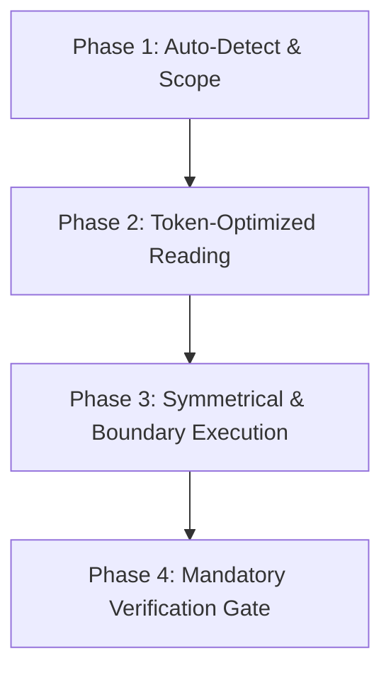

# Unified Master AI Coding Skill (`/code`)

skill รวมศูนย์ — พิมพ์ `/code <คำสั่ง>` แล้วมันจะเลือก pipeline ให้เอง ไม่ต้องจำหลายคำสั่ง

---

## Autonomous 4-Phase Workflow

### Phase 1 — Auto-Detect

1. **BUG FIX / ERROR** — มี stack trace หรืออาการบั๊ก
   → ใช้ pipeline ของ `/swe-agent`: reproduce → localize → patch ให้เล็กที่สุด → verify
2. **FEATURE / FIELD UPDATE (CRUD)** — เพิ่มหรือแก้ field
   → บังคับ **Symmetrical Update**: หน้า list → หน้า detail/form → layer ที่บันทึก → schema/DB
   → ตกอันใดอันหนึ่งคือบั๊ก ไม่ใช่ "ทำทีหลัง"
3. **SCHEMA / PERSISTENCE** — แตะที่เก็บข้อมูล
   → อัปเดต type/model และ layer ที่เขียนพร้อมกัน ห้ามคิดคอลัมน์ที่ไม่มีอยู่จริงขึ้นมาเอง
   → ถ้าโปรเจกต์เป็น DB-first (ไม่มี migration) ให้อ่าน schema จากฐานจริงก่อน

### Phase 2 — Token-Optimized Reading

ไฟล์ > 800 บรรทัด ให้ใช้กฎของ `/token-saver`: Grep หา symbol ก่อน แล้ว Read เฉพาะช่วง

### Phase 3 — Clean Implementation

เขียนให้สะอาดตามกฎ `/ponytail` — ไม่มี fallback ที่ไม่มีใครเรียก ไม่มีฟีเจอร์ที่ยังไม่มีคนขอ
และ **เขียนให้เหมือนโค้ดรอบข้าง** (naming, comment density, สำนวน)

### Phase 4 — Mandatory Verification Gate

**ห้ามข้าม** เลือกคำสั่งตาม stack:

| เจอที่ root | gate |
|---|---|
| `artisan` | `php -l <ไฟล์>` + `php artisan view:clear` (ถ้าแก้ blade) + `curl` หน้าจริงอ่าน status code |
| `tsconfig.json` | `npx tsc --noEmit` แล้วค่อย build ถ้าเป็น user-facing |
| `package.json` | อ่าน `scripts` แล้วรันเฉพาะที่มีอยู่จริง |
| มี test suite | รัน test ที่เกี่ยวข้อง แล้ว quote ผล |

**รายงานผลจริงเท่านั้น** — ถ้า gate ไหนไม่ได้รัน ให้บอกว่าอันไหนและเพราะอะไร

**เปลี่ยนค่าเดียวกันหลายจุด** (สี, class, ข้อความ, ชื่อฟิลด์): ค้นค่าเดิมทั้งโปรเจกต์ก่อนแก้ แล้วแปะ `ก่อน N → หลัง 0`
ถ้ายังเหลือ ให้แสดงทุกจุดพร้อมเหตุผล — ไม่มีตัวเลขนี้ ห้ามบอกว่าครบ

---

## ตัวอย่าง: DOT (Laravel 10 + Blade + Vue 3 + laravel-mix + SQL Server)

- PHP full path:
  `C:\Users\USER\AppData\Local\Microsoft\WinGet\Packages\PHP.PHP.8.2_Microsoft.Winget.Source_8wekyb3d8bbwe\php.exe`
- **ไม่มี migration ของตารางธุรกิจ** — อ่าน schema จากฐานจริงด้วย `INFORMATION_SCHEMA.COLUMNS`
  และเขียน query เป็น T-SQL เท่านั้น (`TRY_CAST`, `LEN()`, `ISNULL`, `SUBSTRING`)
- **ไม่มี FormRequest ทั้งโปรเจกต์** — validation ส่วนใหญ่อยู่ฝั่ง client เท่านั้น
  ถ้าเพิ่มฟิลด์ที่แก้ข้อมูลสำคัญ ต้องเพิ่ม validation ฝั่งเซิร์ฟเวอร์ด้วย
- **`.env` ชี้ฐานข้อมูลจริง** — ทดสอบ write path ด้วย `DB::beginTransaction()` แล้ว `rollBack()`
  และเทียบ snapshot ก่อน/หลังเพื่อพิสูจน์ว่าไม่มีข้อมูลอื่นเปลี่ยน
- Symmetrical update ของ DOT มักเป็น: `routes/web.php` → Controller → Model (`DB::table`) → `.blade.php`
  และอย่าลืมหน้า `preview` / report ที่แสดงค่าเดียวกัน

## ข้อห้าม

- ห้ามรายงานว่าเสร็จโดยไม่ได้รัน gate
- ห้ามเงียบเมื่อใช้ทางลัด (mock, ข้าม test, cache) — ต้องบอกในผลลัพธ์
